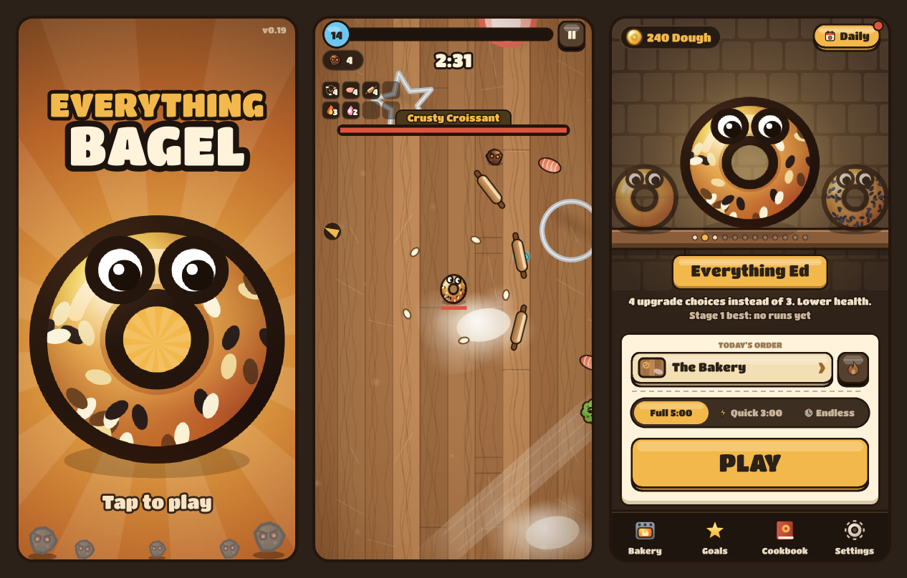

# Everything Bagel

**You are a bagel. Defend the last bakery from the Stale.**

A free, one-thumb survivor game for phones. Runs take about five minutes, it works offline, and it pauses itself when you switch apps.

**Play it:** https://lg13002.github.io/Bagel-Survivor/



## Play it like an app

**iPhone:** open the link in Safari, tap the Share button, choose **Add to Home Screen**, then open the game from its new icon.

**Android:** open the link in Chrome, tap the three dots, choose **Add to Home screen** (or **Install app**).

It then opens full screen and works with no connection. Do this before you play much on an iPhone: progress starts fresh under the new icon.

## How it plays

- Drag anywhere to move. Your weapons fire on their own.
- Pick up seeds to level up, then pick a card: orange cards are weapons, blue cards are toppings. You hold 4 of each, and each goes to level 5.
- A level 5 weapon and its matching topping **evolve** when you open a chest. Elites drop chests.
- Beat the boss at 4:30 to clear the stage and open the next one. There are five stages, from the Bakery counter to the Bread Bin, and an ending.
- Every run pays Dough. Spend it in the Bakery on upgrades that last, and on hats.
- Twelve bagels, each with its own quirk. Twelve weapons, twelve evolutions and two secret recipes.
- A Daily Run with a twist, the same for everyone, with a streak and a score card to share.
- Quick Runs, Endless and Extra Crispy for when the stages are too easy.

## Your save

Progress is kept on your phone, in the browser. Nothing is sent anywhere: no accounts, no ads, no tracking. Settings, Save has a backup code to move your progress to another phone.

## About

Everything is original, drawn in code and synthesized in the browser: there are no image or sound files. Built with Phaser 3, TypeScript and Vite.

- [Release notes](docs/RELEASE_NOTES.md)
- [Notes for developers](CLAUDE.md) and the [build history](docs/HANDOFF.md)

```bash
npm install
npm run dev     # play locally
npm run build   # type check and build
```
